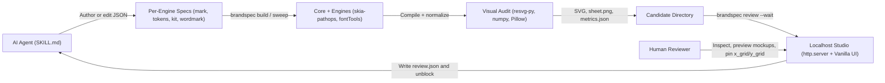
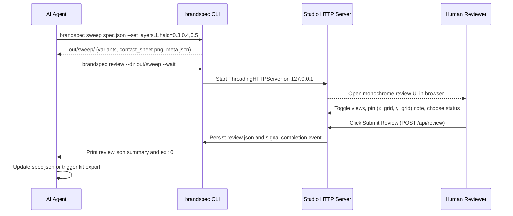
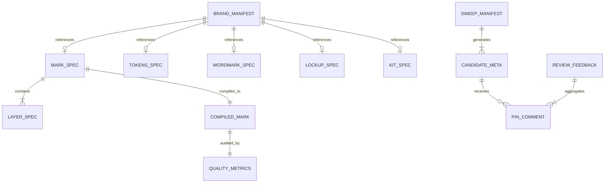

# BrandSpec Master PRD

## Executive Summary and Origin Context

BrandSpec started from a practical frustration: raster image generators produce non-editable pixels, and raw LLM-authored SVGs drift off grid and break at small icon sizes.
The project exists to give AI agents a deterministic vector compiler grounded in the geometric discipline of Jens Muller's *Logo Modernism*.
Rather than competing with browser design suites like Figma or Coolors, BrandSpec adopts an agent-first split of responsibilities.
The Python CLI compiles exact vector geometry, runs automated legibility and contrast gates, and prepares production deliverables.
The human acts as Creative Director in a zero-bloat localhost console, inspecting candidates, pinning spatial coordinates, and approving releases or requesting targeted revisions.
All deliverables remain pure Python and single-wheel installable via `uvx brandspec`, with zero Node.js runtime dependencies.

## Architecture Flow

## Primary Review Lifecycle

## Core Data Model

## Module Directory and Implementation Roadmap

Implementing agents must read [decisions.md](decisions.md) once for product philosophy, UI design tokens, and anti-slop rules, then execute one leaf specification at a time.

| Order | Issue | Module Spec | Scope Summary |
| :--- | :--- | :--- | :--- |
| 0 | Context | [decisions.md](decisions.md) | Positioning, UI design system, and architectural trade-offs |
| 1 | `#1` | [01-halo-join.md](specs/01-halo-join.md) | Configurable `halo_join` and `halo_cap` in `dilate_path` |
| 2 | `#2` | [02-skill-distribution.md](specs/02-skill-distribution.md) | Single canonical `SKILL.md`, `uvx` fallback, and `install-skill` |
| 3 | `#3` | [03-studio-review.md](specs/03-studio-review.md) | Localhost review server, monochrome UI, and `--wait` handoff |
| 4 | `#4` | [04-parameter-sweep.md](specs/04-parameter-sweep.md) | Bounded multi-variant `sweep` command and `studio` integration |
| 5 | `#5` | [05-tokens-and-kit.md](specs/05-tokens-and-kit.md) | Palette tokens, contrast gate, favicon/OG kits, studio mockups |
| 6 | `#5` | [06-wordmark-and-lockup.md](specs/06-wordmark-and-lockup.md) | `fontTools` vector wordmarks, ink traps, and mark lockups |
| 7 | `#5` | [07-icons-and-pattern.md](specs/07-icons-and-pattern.md) | Matched icon sets and seamless tiling SVG textures |
